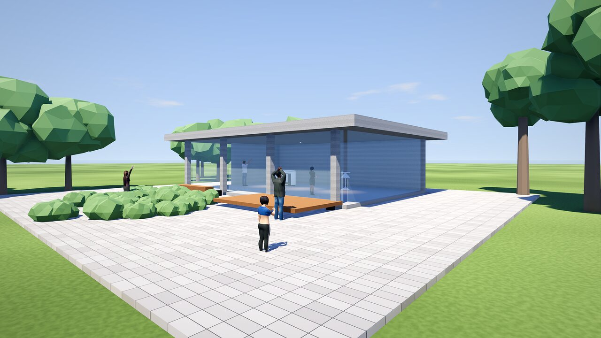
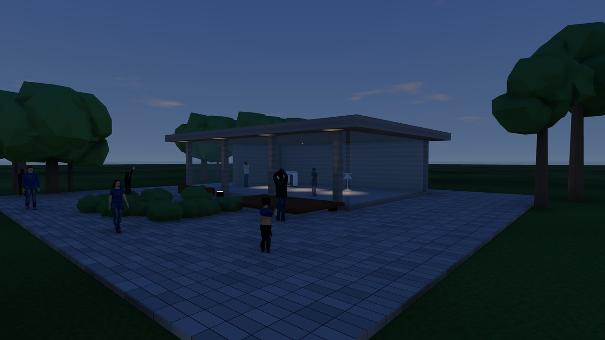
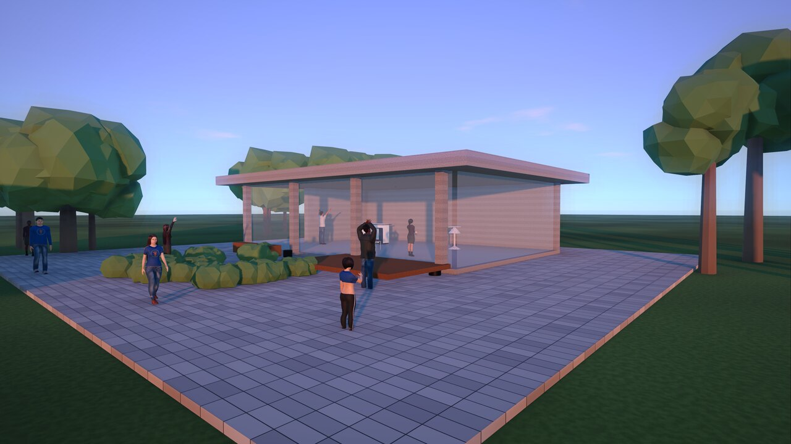
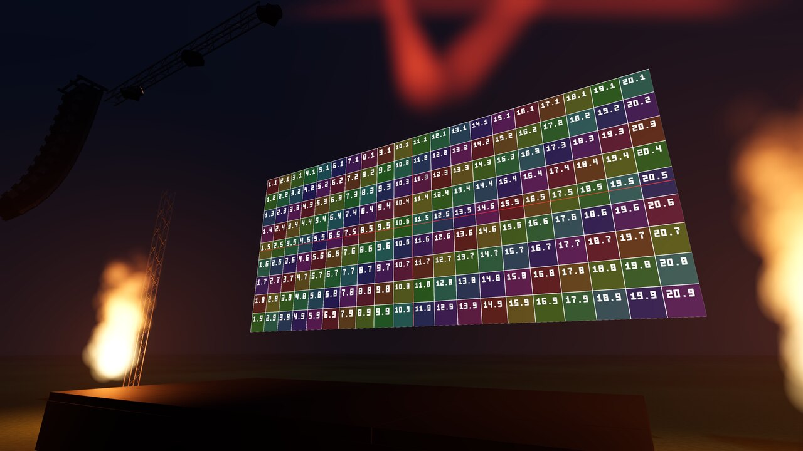
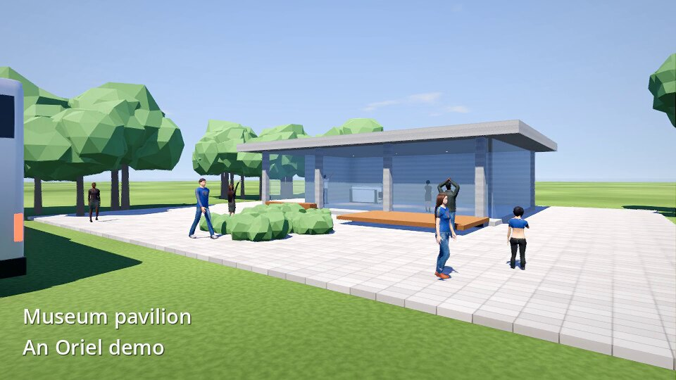
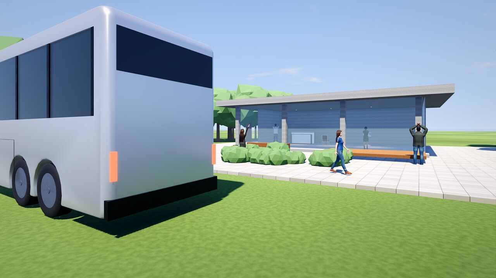

# Oriel

**Import your building. Make it beautiful.** A free, open alternative to Lumion, D5 and V-Ray for architects and event designers.

Oriel is free, open architectural and event visualisation. Bring in a building, put it in its surroundings, light it with the real sun, dress it with materials, plants, people and furniture, stage it with LED walls, truss and moving lights, and make stills, 360° panoramas, virtual tours, fly-throughs and live show run-throughs.

Two kinds of rendering, from the same scene and cameras:

- **Real-time** (Godot): what the 3D view shows, in seconds.
- **Photoreal: Eevee and Cycles**, Blender's render engines, **built into the program**. Nothing else to install: the AppImage carries them and runs them in the background. Eevee is fast and photoreal; Cycles traces light as it really bounces. Pictures come back graded like the editor's view, with each camera's look on top.

And a library to fill the scene: models, materials and skies from **BlendKit**, **Poly Haven** and **ambientCG**, searched from the *Online* page and kept in your own library, plus a starter pack of the most useful ones (in the program, or from a terminal with `--get-assets`).

Oriel is built on the [Genesis](https://github.com/Utopian-Academy/Genesis) editor plugin by Utopian Academy (MIT), turned into a standalone desktop application on the Godot engine: **no Godot editor is needed**. It was called Genesis Community up to 1.0.0-rc3.

> **Release candidate 1.0.0-rc5.** Built and tested on Linux with software rendering (no graphics card on the build machine), and delivered as one AppImage. New in rc5: IFC, USD, Collada and 3DS models; IES lights, lumens and kelvin; the light mixer, more passes and EXR; wind, wet, puddles and snow; relief, caustics, light inside, volumetric clouds; layered materials; keyframes, a timeline, transitions, titles and sound; rows, fills and traffic; Cycles in the 3D view; walking through on a VR headset; and large scenes ([CHANGELOG.md](CHANGELOG.md)). The Windows build is made from the same source but has not yet been run on Windows. See [docs/KNOWN_LIMITATIONS.md](docs/KNOWN_LIMITATIONS.md) before relying on it.

## Get started

**Read [START_HERE.md](START_HERE.md) first**: running it, the first ten minutes, a self-test for your computer, and where everything is kept. The whole manual is also one page, `Oriel-Manual.html` (and `.pdf`), which *Help > Documentation* opens from inside the AppImage.

- Linux: `Oriel-1.0.0-rc5-x86_64.AppImage` ([installation](docs/INSTALLATION_LINUX.md))
- Windows: not in this delivery; it is built from the same source ([installation](docs/INSTALLATION_WINDOWS.md))
- Then the [quick start](docs/QUICK_START.md), [photoreal rendering](docs/RENDERING.md), the [online library](docs/ONLINE_LIBRARY.md) and the [user manual](docs/USER_MANUAL.md).
- Two demo projects come with it: choose one under *Try a demo* on the start screen.

## What the demos look like

Rendered by the program itself, from its two demo projects (Standard quality, software rendering):

| | |
|---|---|
|  |  |
|  |  |
|  |  |

## What it does

| Section | What it does |
|---|---|
| **SCENE** | New scenes; bring in a building (GLB, glTF, FBX, OBJ; .blend, **IFC, USD, Collada, 3DS**, STL, PLY and Alembic through the built-in engine) with **live link** for re-exports; real neighbourhoods from OpenStreetMap, by address or from a saved map file; measuring; layers; **large scenes** (counting, levels of detail, heavy things shown as boxes). |
| **PLANS** | Floor plans from images and PDF pages at true scale; CAD drawings (DXF, CAD-plotted PDF, DWG via ODA) in their layers and colours; walls from lines; snapping to the millimetre. |
| **ASSETS** | 295 CC0 models (people, animals, vehicles, boats, aircraft, furniture, a full production kit), each with its licence; plants; **your own library** of models for every project, each with the licence you give it. |
| **ENVIRONMENT** | Time of day, real sun for any place and date (NOAA), skies (procedural, or **your own HDRI panoramas** with the sun found in them), **volumetric clouds**, haze and stage haze, exposure, weather and seasons, **wind, wet surfaces, puddles and lying snow**. |
| **LANDSCAPE** | Paint plants onto ground, roofs and terrain; **rows and fills** (avenues, lamp posts, parked cars, woods, crowds) from a drawn line; sculpt terrain. |
| **SET** | LED walls from panel specs with planning reports, truss, stage decks, flown line arrays, moving heads, crowds of thousands, effects. |
| **MATERIALS** | Presets (eight drawn by Oriel; scanned ones with the downloaded library), images as materials at real size, tiles and grout, weathering, **layers** (plaster over brick, moss in the joints), **relief** (true displacement in Cycles), light inside, solid glass. |
| **CAMERAS** | Saved views (the main view really moves to them), plans, sections, elevations, photo matching. |
| **LOOK** | Per-camera finish and 14 built-in looks. |
| **RENDER** | Real-time, **Eevee and Cycles**; stills to 8K; all cameras; sun studies; passes and one EXR with Cryptomatte; the **light mixer**; caustics; **IES** lights in lumens and kelvin; 360° panoramas and VR tours; local AI upscaling with Real-ESRGAN. **Cycles in the 3D view** (F10). |
| **MOVIE** | Fly-throughs, orbits, stills, time-lapse sun; **keyframes and a timeline**; transitions, titles and a soundtrack; **paths drawn in the 3D view** for boats and **people walking** (stepping in time with the ground they cover); **traffic** in lanes; phasing; MP4. |
| **SHOW** | Live video on screens (SRT, OBS, vMix, capture, files), cues with GO and fades, full-screen show view, OSC out and (new) in. |
| **View** | **Walk through** the project on the screen (F9) or on a **VR headset** through OpenXR (Shift+F9). |

New in the standalone program: a project manager; a 3D view with orbit, pan, fly, and move/turn/resize handles; a path tool; a scene tree and a properties panel for every object (including all set-piece settings); undo for everything; a project format you can move between computers, with backups, autosave and recovery; importing old Genesis projects (scenes open even without the files they used, with stand-ins); a library of your own models and skies; a dependency manager; a console and log.

## What's free about it

Everything. The code is MIT. The models are CC0. OpenStreetMap data is ODbL ("© OpenStreetMap contributors" on renders that show it). Real-ESRGAN is BSD-3-Clause and runs on your own computer. See [THIRD_PARTY_NOTICES.md](THIRD_PARTY_NOTICES.md) and [docs/ASSET_LICENSING.md](docs/ASSET_LICENSING.md).

## For developers

[docs/ARCHITECTURE.md](docs/ARCHITECTURE.md), [docs/BUILDING_FROM_SOURCE.md](docs/BUILDING_FROM_SOURCE.md), [DEVELOPMENT_STATUS.md](DEVELOPMENT_STATUS.md). Tests: `bash tests/run_app_tests.sh` (headless) and the plugin's `bash tests/run_all.sh` (needs a GPU).

## Credits

Oriel was created by Utopian Academy. Oriel is the standalone edition of that work, under the same MIT licence.
