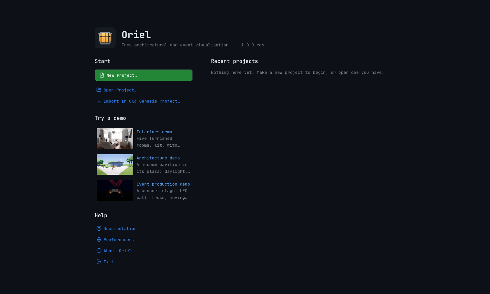

# Start here: Genesis Community 1.0.0-rc1

Genesis Community is free architectural and event visualisation that runs as its own program, with no Godot editor. This page covers getting it running, finding your way around, and checking that it works on your computer.

> **This is a release candidate, not 1.0.0.**
>
> - **Linux:** the build was tested on Ubuntu 24.04 with software rendering. That covers every automated suite, a smoke tour of the built program, and the end-to-end test (build, save, relaunch, verify, render, 360°, upscale, film).
> - **Windows:** the build has **not** been run on Windows yet.
>
> What is still open is listed in [reports/ACCEPTANCE.md](reports/ACCEPTANCE.md) and [docs/KNOWN_LIMITATIONS.md](docs/KNOWN_LIMITATIONS.md).

## What is in this folder

```
Genesis-Community-1.0.0-rc1/
├── START_HERE.md                 this page
├── README.md  CHANGELOG.md  LICENSE  THIRD_PARTY_NOTICES.md  DEVELOPMENT_STATUS.md
├── applications/
│   ├── linux-x86_64/             Genesis.x86_64, Genesis.pck, Genesis.sh, genesis.png
│   └── windows-x86_64/           Genesis.exe, Genesis.pck, Genesis.bat, Genesis.ps1
├── demos/
│   ├── architecture/             a museum pavilion: daylight, golden hour and night scenes
│   └── event-production/         a concert stage: LED wall, truss, line arrays, moving heads, crowd, cues
├── docs/                         Genesis-Community-Manual.html (and .pdf): every page below in one file
├── reports/                      acceptance against the brief, end-to-end results, audits
├── source/                       the complete source code of exactly this build
├── tests/  tools/                test suites; build, release and launcher scripts
└── checksums/SHA256SUMS
```

Each program needs the `.pck` file next to it. Keep the two files together.

## 1. Check the download (optional)

Linux:

```bash
cd Genesis-Community-1.0.0-rc1
sha256sum --quiet -c checksums/SHA256SUMS && echo "All files OK"
```

Windows (PowerShell). This prints only the files that do not match:

```powershell
cd Genesis-Community-1.0.0-rc1
Get-Content checksums\SHA256SUMS | ForEach-Object {
  $h, $f = $_ -split '  ', 2
  if ((Get-FileHash -Algorithm SHA256 $f).Hash.ToLower() -ne $h) { "MISMATCH $f" } }
```

## 2. Run it on Linux (Ubuntu or Kubuntu 24.04)

```bash
unzip Genesis-Community-1.0.0-rc1.zip -d ~/Applications
cd ~/Applications/Genesis-Community-1.0.0-rc1/applications/linux-x86_64
./Genesis.sh --check              # graphics device and optional tools found
./Genesis.sh                      # start Genesis
./Genesis.sh --install-shortcut   # optional: add it to the applications menu
```

- Nothing is installed system-wide, and no administrator rights are needed.
- If the files lost their permissions in unpacking, run `chmod +x Genesis.x86_64 Genesis.sh`.
- To start with a project already open, run `./Genesis.sh "/path/to/My Project"`.

**Graphics.** Genesis uses Vulkan 1.2. Check what it will run on:

```bash
sudo apt install vulkan-tools
vulkaninfo --summary | grep -E "deviceName|driverName"
```

- With an NVIDIA card, the list should name it; `nvidia-smi` confirms the driver.
- If the list shows only `llvmpipe`, Vulkan is running in software. Genesis still works that way, but slowly; it is how this release was tested. To use the card, install its driver (`sudo ubuntu-drivers install`) and restart.

## 3. Run it on Windows 10 or 11

1. Right-click the zip and choose *Extract All*. Pick a folder you can write to, such as `Documents`.
2. Open `applications\windows-x86_64` and double-click **Genesis.bat**.
3. SmartScreen may warn that the program is not recognised, because it is not code-signed. Choose *More info*, then *Run anyway*.

For a Start-menu and desktop shortcut:

```powershell
powershell -ExecutionPolicy Bypass -File Genesis.ps1 -InstallShortcut
```

Because this build has not yet been run on Windows, run the self-test first (section 6) and keep its result.

## 4. Your first ten minutes



1. **Open a demo.** Choose *Open Project…* and select the `demos/architecture` folder. To keep the originals clean, copy the demos somewhere first, for example `cp -r demos ~/Genesis-Projects`.
2. **Look around.**
   - Middle-drag orbits, Shift + middle-drag pans and the wheel zooms.
   - On a laptop, Alt + left-drag orbits.
   - **F** frames the selection and **Home** frames everything.
   - **F1** lists every key and mouse action.
3. **Select and arrange.**
   - Click an object, or pick it in the *Scene* tree on the left.
   - Drag the arrows to move it. **E** switches to the rings (turn) and **R** to the boxes (resize). Hold **Ctrl** to snap.
   - Every change can be undone with **Ctrl+Z**.
4. **Change it in the Properties panel.** Every setting of the selected object is there, down to an LED wall's panel size and pixel pitch.
5. **Use the Genesis panel on the right.** Its twelve sections run in working order: Scene, Plans, Assets, Environment, Landscape, Set, Materials, Cameras, Look, Render, Movie and Show.
   - Try *Environment*: change the time of day and watch the sun move.
6. **Render.** Go to *Render*, choose a camera, a size and a quality, and press render.
   - *Preview* is quick. *Standard* is for most stills. *High* and *Maximum* take 16 and 64 samples.
   - Pictures go to the project's `renders/` folder.
   - After a still, *Upscale ×2/×4* sharpens it with Real-ESRGAN. The first time, it downloads the upscaler (about 47 MB).
7. **Make a film.** *Movie* moves between saved cameras and writes an MP4. This needs FFmpeg (section 5).
8. **Run a show.** Open `demos/event-production`, go to *Show*, and press **GO** to step through the four cues.
9. **Save.** Press **Ctrl+S**. Genesis also keeps unsaved work every few minutes, and keeps the last five saved versions in `backups/`.

Then start your own project:

1. Choose *New Project…*. The new project already has a sun, a sky and ground.
2. Choose *File > Bring In a Model…* (**Ctrl+I**), or drop a model file on the window. GLB, glTF, FBX and OBJ work directly; `.blend` files need Blender.
3. Say what unit the model was made in and which way is up.
4. With *Live link* on, re-exporting from your modelling program updates the model in Genesis.


## 5. Optional tools

Genesis runs without any of these. Each one adds a single feature. *Tools > Dependencies…* shows which ones Genesis has found.

Ubuntu 24.04:

```bash
sudo apt install ffmpeg            # MP4 films; live video on LED walls and screens
sudo apt install poppler-utils     # PDF pages as plans
sudo apt install blender           # .blend files (or a newer Blender from blender.org; set its path in Tools > Dependencies)
```

Windows:

```powershell
winget install Gyan.FFmpeg
winget install BlenderFoundation.Blender
```

**DWG drawings** need the ODA File Converter from opendesign.com. It is free to download but not open source. DXF works without it: export DXF from your CAD program.

**Real-ESRGAN by hand.** Use this only if the in-app download is blocked, for example by a proxy. It installs the same files to the same place, and Genesis finds them there.

Linux:

```bash
D=~/.local/share/Genesis/tools/realesrgan
mkdir -p "$D" && cd "$D"
wget https://github.com/xinntao/Real-ESRGAN/releases/download/v0.2.5.0/realesrgan-ncnn-vulkan-20220424-ubuntu.zip
echo "e5aa6eb131234b87c0c51f82b89390f5e3e642b7b70f2b9bbe95b6a285a40c96  realesrgan-ncnn-vulkan-20220424-ubuntu.zip" | sha256sum -c
unzip -o realesrgan-ncnn-vulkan-20220424-ubuntu.zip && rm realesrgan-ncnn-vulkan-20220424-ubuntu.zip
chmod +x realesrgan-ncnn-vulkan
curl -L -o LICENSE.txt https://raw.githubusercontent.com/xinntao/Real-ESRGAN/master/LICENSE
```

Windows (PowerShell):

```powershell
$D = "$env:APPDATA\Genesis\tools\realesrgan"
New-Item -ItemType Directory -Force $D | Out-Null; Set-Location $D
curl.exe -L -o rg.zip https://github.com/xinntao/Real-ESRGAN/releases/download/v0.2.5.0/realesrgan-ncnn-vulkan-20220424-windows.zip
(Get-FileHash rg.zip -Algorithm SHA256).Hash   # must be ABC02804E17982A3BE33675E4D471E91EA374E65B70167ABC09E31ACB412802D
tar -xf rg.zip; Remove-Item rg.zip
curl.exe -L -o LICENSE.txt https://raw.githubusercontent.com/xinntao/Real-ESRGAN/master/LICENSE
```

## 6. Check that it works on your computer

**Self-test.** This takes about 20 seconds. It makes a project in a temporary folder, fills it, saves it, reopens it and deletes it. Your own projects and settings are not touched.

Linux:

```bash
./Genesis.x86_64 --headless -- --smoke --expect-library     # ends with: GENESIS_SMOKE RESULT PASS
```

Windows (PowerShell, in `applications\windows-x86_64`). A Windows program prints to the log rather than the console:

```powershell
Start-Process -Wait .\Genesis.exe -ArgumentList '--headless','--','--smoke','--expect-library'
Select-String -Path "$env:APPDATA\Genesis\logs\godot.log" -Pattern 'GENESIS_SMOKE (RESULT|FAIL)'
```

**End-to-end test.** This is the full test from the brief, in three launches, with real rendering. On a computer with a GPU it takes a few minutes; in software it takes about 40.

1. *build* makes a project, brings in models and a drawing, paints trees, sets the sun, adds set pieces and cues, then saves and quits.
2. *verify* reopens the project, checks every object and setting, then renders 1080p, 4K and a 360° panorama.
3. *media* covers upscaling, which needs the internet the first time, and the film, which needs FFmpeg.

```bash
./Genesis.x86_64 -- --e2e build  ~/genesis-e2e
./Genesis.x86_64 -- --e2e verify ~/genesis-e2e
./Genesis.x86_64 -- --e2e media  ~/genesis-e2e
cat ~/genesis-e2e/E2E_RESULTS_*.md
```

On Windows, run the three phases one after another. Each `Start-Process -Wait` waits for its phase to finish:

```powershell
foreach ($phase in 'build','verify','media') {
  Start-Process -Wait .\Genesis.exe -ArgumentList '--','--e2e',$phase,'C:\genesis-e2e' }
Get-Content C:\genesis-e2e\E2E_RESULTS_*.md
```

## 7. Where Genesis keeps things

| What | Linux | Windows |
|---|---|---|
| Settings and the recent-projects list | `~/.local/share/Genesis/settings.json` | `%APPDATA%\Genesis\settings.json` |
| Logs (*Help > Show the Log Folder*) | `~/.local/share/Genesis/logs/` | `%APPDATA%\Genesis\logs\` |
| Downloaded tools (Real-ESRGAN) | `~/.local/share/Genesis/tools/` | `%APPDATA%\Genesis\tools\` |
| Caches (safe to delete) | `~/.local/share/Genesis/cache/` | `%APPDATA%\Genesis\cache\` |
| Your projects | wherever you make them | wherever you make them |

**Projects.** A project is a folder: `genesis.project.json`, `scenes/`, `assets/`, `data/`, `renders/` and `backups/`.

- You can copy or move it to another computer, including between Linux and Windows.
- If files it uses are elsewhere, *File > Find Missing Files…* finds them.
- Projects made with the original Genesis plugin come in through *File > Import an Old Genesis Project…*. The original is left untouched.

See [docs/PROJECT_FORMAT.md](docs/PROJECT_FORMAT.md) for the full format.

**To uninstall:**

1. Run `./Genesis.sh --remove-shortcut` if you added one.
2. Delete the unpacked folder.
3. Optionally, delete the data folder in the table above.

## 8. Source code, tests and building it yourself

`source/` is the code of exactly this build. The git repository with its full history comes as `genesis-repo.bundle`:

```bash
git clone -b standalone genesis-repo.bundle genesis && cd genesis && git log --oneline | head
```

You need Godot 4.7.2 and its export templates to run the tests or build the programs:

```bash
curl -L -o godot.zip https://github.com/godotengine/godot-builds/releases/download/4.7.2-stable/Godot_v4.7.2-stable_linux.x86_64.zip
unzip godot.zip -d ~/tools/godot
curl -L -o templates.tpz https://github.com/godotengine/godot-builds/releases/download/4.7.2-stable/Godot_v4.7.2-stable_export_templates.tpz
mkdir -p ~/.local/share/godot/export_templates/4.7.2.stable
unzip -j templates.tpz 'templates/*' -d ~/.local/share/godot/export_templates/4.7.2.stable
echo "GODOT=$HOME/tools/godot/Godot_v4.7.2-stable_linux.x86_64" | tee tests/local.env

bash tests/run_app_tests.sh                       # headless suites and the smoke tour, about 1.5 minutes
bash tools/build_standalone.sh linux windows      # build/linux and build/windows; the Linux build is smoke-tested
build/linux/Genesis.x86_64 -- --make-demos ~/genesis-demos                       # the two demo projects
build/linux/Genesis.x86_64 -- --render-samples ~/genesis-demos/"Architecture demo"
python3 tools/build_release.py --skip-build --demos ~/genesis-demos              # release/Genesis-Community-<version>.zip
```

- The original editor plugin still works. Open the folder in the Godot 4.7.2 editor and Genesis appears as a dock.
- The plugin's own suites run with `bash tests/run_all.sh`. They need a GPU.
- [docs/ARCHITECTURE.md](docs/ARCHITECTURE.md) explains how the program is put together.

## 9. What has been tested, and what has not

**Tested** on Ubuntu 24.04 with software Vulkan (lavapipe):

- 277 headless checks.
- The built program's smoke tour.
- The end-to-end test with real renders: 1080p, 4K, 360°, Real-ESRGAN, MP4 and a concert render.
- Saving and reopening across launches.
- Both demo projects, built and rendered by the program itself.

**Not tested here:**

- Windows, which also failed to start under Wine.
- A real GPU.
- `.blend` import (no Blender) and FBX (no sample file).
- PDF and DWG plans.
- OpenStreetMap site context (no internet access to it).
- Photographed HDRI skies and scanned material presets. They are not bundled; build them with `python3 tools/setup.py` on a computer with internet access.
- Live video sources and outgoing OSC.

If you try any of these, the result is what turns this release candidate into 1.0.0. The full list is in [reports/ACCEPTANCE.md](reports/ACCEPTANCE.md).

## 10. When something goes wrong

- [docs/TROUBLESHOOTING.md](docs/TROUBLESHOOTING.md) covers the common problems.
- *Help > About > Copy diagnostics* copies the version, system, graphics and tools, which is what a bug report needs.
- *Help > Show the Log Folder* opens the logs.

## Licence

- Genesis Community's code is under the MIT licence, the same as the original Genesis by Utopian Academy.
- The 295 bundled models are CC0, and each keeps its licence file.
- Godot is MIT.
- [THIRD_PARTY_NOTICES.md](THIRD_PARTY_NOTICES.md) lists every component and its licence.
