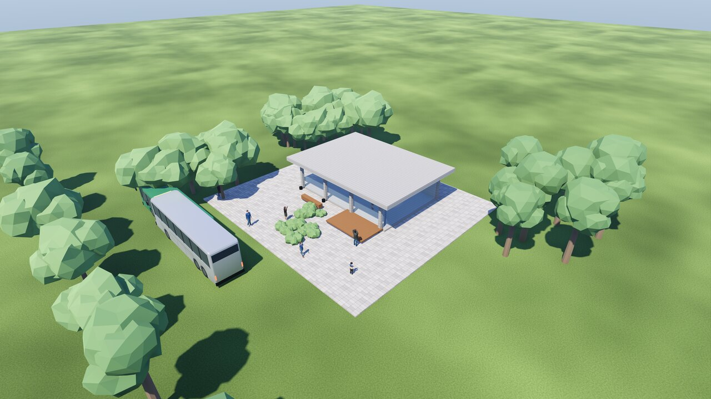

# Landscape

LANDSCAPE section: choose a plant, then drag in the 3D view to paint; Shift-drag erases. Brush size, density, size variation and random turning. *Paint onto surfaces* plants on roofs, terrain and planters. Plants are drawn as instanced copies (one draw call per mesh, however many), so tens of thousands are practical.

The plants are the bundled stand-in trees, shrub and grass, the 54-species library when `tools/setup.py` has built it, and any plants, trees and grass you have added to your own library on the Assets page (listed with *yours*).

Sculptable terrain: raise, lower, smooth, flatten and paint the ground.

A whole stroke is one undo step.

## Rows and fills

*Draw a spread* (Landscape page, *Rows and fills*): click points in the 3D view, press Enter. Then, in Properties:

- **Layout**: *Along the line* (an avenue of trees, lamp posts down a street, cars parked along a kerb, a hedge) or *Inside the outline* (a wood, a crowd standing in a square, a car park full).
- **Shelf**: which shelf of the library the things come from (trees, plants, grass, people, vehicles, furniture, architecture, props, lighting, animals), and **Only**: words their names must have ("bench, bin").
- Along a line: **Spacing**, **Aside** (metres to one side of the line) and **Both sides**. Inside an outline: how many **per 100 m²**.
- **Out of line** (0 is a drill square), **Smallest** and **Largest**, **Facing** (any way, along the line, towards it, away from it), **On surfaces** (they stand on whatever is under them: ground, terrain, a deck), **Seed** (another arrangement of the same).

The library supplies the variety: every model on the shelf that fits takes its turn. Reshape the line (drag a point, Ctrl+click to add one, right-click to remove one) and everything follows. A spread is drawn as a few batches however many things it holds (up to 20,000), and goes to Eevee and Cycles as copies.
