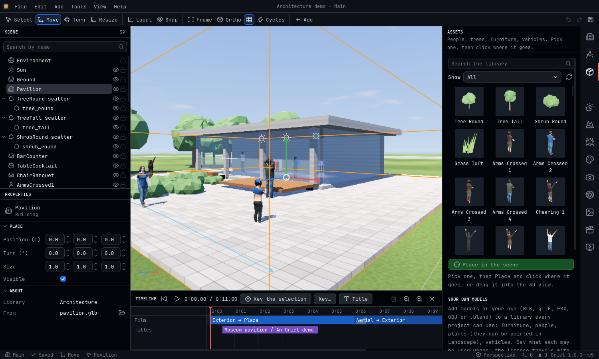

# Movies and animation

MOVIE section: a film is a list of shots, each a glide through saved cameras, a still from one camera, or an orbit around a point. Preview, then render to MP4 (FFmpeg). Before rendering Oriel warns where the camera would pass through a tree or a wall.

- **Time-lapse sun** through the film.
- **Moving objects**: traffic, boats and people walking along paths you draw in the 3D view. *Draw a path*, click points on the ground, a deck or a roof, press Enter; drag points to reshape it, Ctrl+click the line to add one, right-click to remove one. Put the selection on it; set speed, direction and curves in the Properties panel. The walkers from *Assets > People* walk as they go, their stride matched to the ground they cover. Things on a path are spaced evenly and loop: at the end they start again from the beginning.
- **Phasing**: objects rise from the ground, grow or appear at set times (a building going up).

Without FFmpeg the frames are saved as PNGs in `renders/<film>/`.

A walkthrough in the style of Lumion: bring in the model, paint plants, set the sun, draw a path through the site, put walkers (and cars) on it, save a camera or two, add a shot, and render the film. The end-to-end test does exactly this and checks that the walkers move and step in the rendered MP4 (see reports/E2E_RESULTS_walk.md).

## Photoreal films

With *Eevee* or *Cycles* chosen on the Render page, the Movie page renders the film through them: every frame's camera, a time-lapse sun and everything that moves (moving-objects paths, flying screens, the build-up phasing) go to the engine, which renders the frames one by one into `renders/<scene>_movie_<engine>/`. A stopped film keeps its frames, and rendering again carries on from the first missing one; if the film changed in the meantime, it starts again. The frames get the camera's look and are joined into `<scene>_movie_<engine>.mp4` when FFmpeg is installed. In a photoreal film, video on LED walls stays at its first frame and particles are not drawn. See [RENDERING.md](RENDERING.md).

## Keys and the timeline

*View > Timeline* (Ctrl+T) opens the timeline under the 3D view. It shows the film's length, its shots, its titles and a row for everything that has keys. Drag in the ruler (or press Left and Right) to move through the film; Space plays.

- **Key the selection** (K): records how the selected objects are at this moment of the film: place, turn and size; a light's brightness and colour; a camera's lens. Move to another moment, change them, key again: in between they move from one to the other. A camera with keys can be used in a shot like any other.
- **Key…**: records the sun (the time of day), the sky (clouds, fog, haze) or the weather (wet, puddles, snow, wind) as it is now, or whether the selection shows.
- A key is a diamond on its row. Click to pick it, drag it to another time, Delete to remove it. **How it leaves**: Smooth, Linear, Glide (a place runs through its keys without stopping), Ease in, Ease out, Hold (jumps at the next key).

Keys are kept in the scene with the film. They play in the 3D view, in real-time films and in Eevee and Cycles films alike.

## The edit: transitions, titles, sound

On the Movie page, *The edit*:

- **Selected shot comes in with**: Cut, Dissolve, Through black, Through white; **Taking** says how long. (On the timeline, pick a shot to set the same.)
- **Fade to black at the end**.
- **Soundtrack…**: a sound file (MP3, WAV, OGG, FLAC, M4A, AAC, Opus) laid under the whole film, with **Its volume**; it fades out over the film's last two seconds.
- **Titles**: *Title* on the timeline puts words on the picture from the moment shown, for four seconds; they fade in and out. Double-click the title's bar to change its words (one or more lines), where they stand (lower left, lower middle, centre, top left, top middle) and their size; drag the bar to move it, its end to make it longer; Delete removes it.

The edit is done by Oriel itself on the finished frames, so a real-time film and an Eevee or Cycles film are cut the same way, and a stopped photoreal film still carries on where it stopped.

## Traffic

*Draw traffic* (Movie page, *Moving objects*): click the road's line, press Enter. In Properties: **Traffic** (Cars; Cars and vans; City traffic; Buses and coaches; People walking), **Gap** (metres from one to the next), **Lanes**, **Lane width**, **Both ways**, **Drive on** (right or left), **Unevenness**, **Speed** and **Speed spread** (how much one lane's speed differs from another's), **Seed**. The library supplies the variety. In a film everything travels at its lane's speed, keeps its distance and goes round again at the end; up to 300 on a road.
