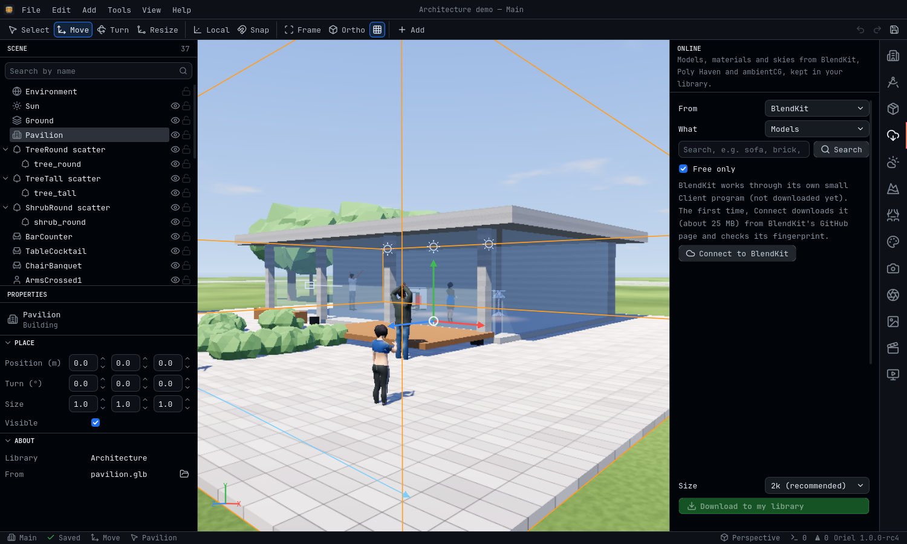

# The online library

The **Online** page brings models, materials and skies from three free libraries into **your own library**, where every project can use them:

| Source | What | Licence | Account |
|---|---|---|---|
| **BlendKit** (blendkit.com, formerly BlenderKit) | tens of thousands of models, materials and skies; many free, more for subscribers | royalty-free or CC0, shown with each asset | a free BlendKit account to download |
| **Poly Haven** (polyhaven.com) | skies (HDRIs), scanned materials, models | CC0 (public domain); powered by Poly Haven | none |
| **ambientCG** (ambientcg.com) | materials, skies | CC0 | none |



Choose where from and what, search (or leave the search empty to see the most popular), pick one, choose a size (1k, 2k, 4k) and **Download to my library**. Then:

- a **model** is on the Assets page under *Your own*, in its category, ready to place;
- a **material** is a preset on the Materials page, projected in world space at its real size;
- a **sky** is in the Environment page's list of skies.

Each one carries its licence record (source, author, licence, attribution if needed) beside it, as every asset in Oriel does.

## BlendKit

BlendKit works through its own small **Client** program, the one its Godot, Blender and other add-ons use. The first time you press **Connect to BlendKit**, Oriel downloads the Client (about 25 MB) from BlendKit's own release on GitHub, checks it against its fingerprint, and keeps it in `~/.local/share/Oriel/tools/blendkit/`. **Log in** opens BlendKit's login page in your browser; when you are logged in there, Oriel notices. *Free only* (on by default) shows the free assets.

Models come as glTF files BlendKit makes for Godot. Materials and skies come as Blender files: Oriel's built-in Blender engine turns a material into its pictures (colour, roughness, normal) and a sky into an `.hdr`.

## The starter pack

**Download the starter pack** gets the most useful free assets in one go: skies for every time of day, the materials buildings and sites are made of, and furniture, plants and props. It takes the favourites listed in `addons/genesis/data/starter_pack.json` first, then each source's most downloaded in the useful categories.

| Size | About | Skies | Materials | Models |
|---|---|---|---|---|
| Small | 150 MB | 6 | 12 | 6 |
| Standard | 700 MB | 16 | 41 | 20 |
| Large | 2.5 GB | 32 (4k) | 88 | 50 |

With BlendKit connected and logged in, the standard and large packs also get BlendKit's best free models (sofas, chairs, tables, beds, desks, kitchens, plants, trees, lamps, cars) and materials.

### From a terminal

The same pack, without opening Oriel (for a computer that is left to download overnight, or a slow line):

```bash
./Oriel-1.0.0-rc5-x86_64.AppImage --get-assets --size standard
./Oriel-1.0.0-rc5-x86_64.AppImage --get-assets --list            # what it would get, nothing downloaded
./Oriel-1.0.0-rc5-x86_64.AppImage --get-assets --only skies --size large
```

`--get-assets` runs `oriel_assets.py` with Oriel's own Python, so nothing needs installing. From the source, it is `python3 tools/oriel_assets.py` (Python 3.8 or newer, standard library only, Linux, Windows or macOS). Oriel adds what the script downloaded to the library the next time its Online page opens. BlendKit's assets need its Client and a login, so they come through the Online page.

## Your downloads are safe

- **Nothing half-written is ever used.** Every file is written as `name.part`, and becomes `name` only when it is whole and matches the checksum the source publishes (Poly Haven's MD5s, BlendKit's Client fingerprint).
- **A stop loses nothing.** Press *Stop*, close Oriel, lose the connection, or press Ctrl+C in the script: what was downloaded stays, and the next try carries on from where it stopped (HTTP ranges), file by file and asset by asset.
- **Server limits are waited out.** When a server says "too many requests" (HTTP 429) or "busy" (503), Oriel waits as long as it asks, says so, and carries on; a source that cannot be reached at all is left for the next run instead of holding everything up.
- **Nothing is downloaded twice.** What is already here and checks out is kept.
- **A record of everything**: `library/online/manifest.json` lists every asset with its source, licence, author, files and state (complete, or unfinished and why). It is written to a new file and then moved into place, with the previous one kept as `manifest.json.bak`, so a crash or a full disk never leaves it broken.
- The originals are kept under `library/online/<source>/`, beside what Oriel made of them.

The library is `~/.local/share/Oriel/library/` (Windows: `%APPDATA%\Oriel\library`). *Show my library folder* opens it. To move it to another computer, copy the folder.
