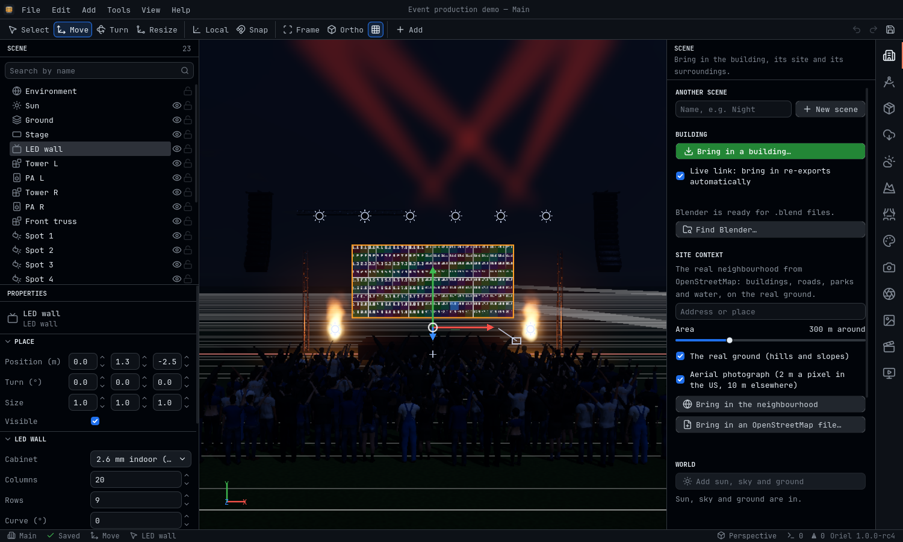

# The Genesis panel, section by section

The Genesis panel sits on the right of the window. **Ctrl+B** shows or hides it. Its twelve sections run in working order: model in, surroundings, staging, materials, then shots and output.

- A section acts on the open scene. Most act on what is selected.
- Everything they do can be undone with **Ctrl+Z**.
- Objects they add appear where the 3D view is looking, selected. You can then move them with the handles and change them in the **Properties** panel on the left.

Button and option names below are as they appear in the program.

## SCENE: the building and the world

**Scene.** Type a name and press *New scene*. Use this for variants of the same project: day and night, option A and option B. Each scene is a file in the project's `scenes/` folder.

**Building.**

- *Bring in a building…* does the same as *File > Bring In a Model…* (Ctrl+I).
- GLB, glTF, FBX and OBJ come in directly. `.blend` files go through Blender; *Find Blender…* tells Genesis where Blender is.
- With *Live link* ticked, Genesis watches the source file. When you export again from SketchUp, Revit, Rhino, Archicad or Blender, it brings the new version into the same place. It keeps the model's position, the materials you changed in Genesis, and anything you put inside it.

**Site context.** This brings in the real neighbourhood from OpenStreetMap: buildings, roads, parks and water, on the real ground.

1. Type an address or place.
2. Choose the *Area* (100 to 800 m around).
3. Tick *The real ground (hills and slopes)* and *Aerial photograph* if you want them.
4. Press *Bring in the neighbourhood*.

This needs the internet. Renders that show the data carry "© OpenStreetMap contributors".

*Bring in an OpenStreetMap file…* does the same from a map saved on openstreetmap.org (*Export* there saves `map.osm`), for a computer that cannot reach the map services. Untick the ground and the photograph when offline: they come from the internet. The live services were not tested in this release (the build machine could not reach them); bringing in a map file was.

**World.** *Add sun, sky and ground* sets up the lighting. A new project already has them.

**Measure.** Press *Start measuring*, then click two points in the 3D view. The dimension stays in the scene. Right-click or Esc starts again.

**Layers.** Name a layer and use *Put selection on it*. You can then show or hide the layer as a group: landscaping, furniture, option A.

## PLANS: drawings under the design

**Floor plan.**

1. *Bring in a plan (image or PDF)…* lays the plan under the scene.
2. Give it its real size: press *Set its scale: click two points on it*, click two points whose distance you know, type that distance, and press *Apply*.

For a PDF, choose the scale the sheet states, such as 1:100, under *PDF: the sheet says*. PDF pages need Poppler or MuPDF.

**CAD drawing.** *Bring in a drawing (DXF, DWG or CAD PDF)…* brings in the real lines at true size, with their layers and colours.

- Choose the drawing's *Units*.
- Tick a layer to show it. *Walls* raises that layer's lines into walls, for a quick massing model from a plan.
- In a PDF plotted from CAD, each pen becomes a layer. The heaviest pen is usually the walls.
- DXF needs nothing extra. DWG needs the ODA File Converter.

## ASSETS: the library

1. Choose a *Category*: people, animals, vehicles, boats, aircraft, furniture, the production kit, plants and so on.
2. Choose a model and press *Place in scene*.

Every one of the 295 models is CC0 and keeps its licence file (see [ASSET_LICENSING.md](ASSET_LICENSING.md)).

**Your own models.** Add models of your own to a library that every project can use: furniture, people, plants, vehicles, anything.

1. Press *Add a model…* and choose a GLB, glTF, FBX or OBJ file (a `.blend` file works when Blender is installed).
2. Give it a *Name* and a *Category*, and say what unit it was *Made in* (metres, centimetres, millimetres, inches or feet). GLB, glTF and FBX files carry their own size, so leave those at *Metres*; an OBJ file does not, so choose the unit it was modelled in.
3. Say which way is up (*Y* for glTF and Blender exports, *Z* for CAD, SketchUp and 3ds Max), and under *May be used under* choose *My own work*, *CC0 1.0*, *CC BY 4.0*, *CC BY-SA 4.0* or *Other* (then describe it under *Licence*). Add the *Author*, *Where it came from* and a *Credit line* if the licence asks for one. A model without a licence is not added.
4. Press *Add*. It appears in its category marked *(yours)*, and under the *Your own* filter.

- Models in the *Trees*, *Plants* and *Grass* categories can also be painted on the Landscape page.
- The library is a folder of your own (*Open your library folder*): `~/.local/share/Genesis/library/` on Linux, `%APPDATA%\Genesis\library\` on Windows. Each model is a `.scn` file with its `.license.json` beside it.
- A project that uses one of your models gets its own copy in `assets/library/`, so it still opens on another computer or after you remove the model.
- *Remove it* takes the selected model out of your library. The bundled models cannot be removed.

**Place along a line** makes rows of chairs, bollards, street trees or a queue of people:

1. Pick a model.
2. Set the spacing with *Every* (0.3 to 30 m).
3. Choose how they face under *Facing*: along the line, across it, or at random.
4. Press *Start placing along a line*, then click the start and the end of the line in the 3D view.

## ENVIRONMENT: sun, sky and weather

**Sun.**

- *Time of day* runs from 5:00 to 21:00. *Sun direction* turns the sun around the site, and *Sun strength* sets its brightness.
- For the real sun, choose a *Place*, or set *Latitude*, *Longitude* and *Clock (UTC offset)*, and choose a *Date*. The sun's height and direction then follow NOAA's solar position algorithm. Use this for shadow studies.

**Sky.**

- Choose a procedural sky (*Clear*, *Hazy*, *Overcast*), or a photographed one.
- *Add a sky image…* adds a sky of your own: a 360° panorama, twice as wide as it is high (equirectangular). HDR (`.hdr`) is best; JPG, PNG and WebP work too. It joins the list for every project and becomes this scene's sky; the sun is put where the photo's sun is. Free HDRI skies are at polyhaven.com (CC0).
- The photographed skies of the downloaded library appear in the list once installed with `tools/setup.py` (see Known limitations).
- *Distance haze* softens the far distance.
- *Stage haze (shows beams)* makes light beams visible in the air.
- *Clouds* sets the cloud cover.

**Weather.**

- Choose *Clear*, *Rain* or *Snow*, with *Heaviness*.
- *Wet ground* and *Puddles* make surfaces wet.
- *Season* tints the leaves and the grass: fresh in spring, browner in autumn, straw-coloured in winter.

**Light.** *Exposure* sets how bright the whole picture is. *Sky light* sets how much the sky lights the scene.

## LANDSCAPE: plants and terrain

1. Choose a *Brush*:
   - *Paint plants*
   - *Paint the ground*
   - *Raise ground*, *Lower ground*, *Smooth ground* or *Flatten ground*
   - *Wipe the ground*
2. Choose a *Plant*, or a *Ground* to paint.
3. Press *Start painting*, then drag in the 3D view. Hold **Shift** to erase. Each stroke is one undo step.

The plants are the bundled stand-in trees, shrub and grass, plus any plants and trees you have added to your own library on the Assets page.

Adjust the brush as you go:

- *Size* and *Density*.
- *Variation*: the *Smallest* and *Largest* plant scale, and *Random rotation*.
- *Paint on any surface (terrain, roofs, planters)* lets plants land on roofs and planters, not only the ground.

**Terrain and water.**

- *Add terrain (replaces the flat ground)* gives you ground to sculpt and paint. A terrain holds up to four ground types.
- Water comes as a pond, pool, river or ocean.

## SET: staging at real sizes



**Add:**

- *LED wall*
- *Stage deck*
- *Truss span*
- *Goalpost (two towers and a span)*
- *Circle truss, 8 m across*
- *Flying screen (LED wall under a helicopter)*

Select a piece to change it in the Properties panel. For an LED wall, that means the panel type and pitch, columns and rows, curve, height above the floor, content (an image or a video), live source and brightness. For a truss, it means length.

**Sound.** *Line array, flown*.

**Lights.**

- Moving heads, washes, downlights and bulbs, plus *Moving spot (real fixture)* and *LED wash (real fixture)* with real photometric data.
- In the Properties panel, set colour, lumens, dimmer, beam angle, pan and tilt.
- Beams show in the air when *Stage haze* is on (ENVIRONMENT).

**Effects.** Fire, smoke, fountains, falling leaves, confetti, CO2 jets, cold sparks and flame projectors. They are warmed up, so a still shows them in full. Size and amount are in the Properties panel.

**People.** A crowd faces its own forward direction, so turn it to face the stage. Its density is in people per m².

**Selected.**

- For an LED wall, this shows a planning report: size in metres and pixels, cabinets, pitch, weight, power (kW, and amps at 230 V and 120 V), data ports and the best viewing distance. These are **planning estimates**; check them against the manufacturer's data.
- *Save pixel map for the processor…* writes the wall's pixel map as a picture for the LED processor.

## MATERIALS

1. Select an object.
2. Pick one of its *Surface*s (a model usually has several).
3. Give it a material in one of three ways:
   - **Presets**: asphalt, brick, concrete, glass, grass, metal, stone and wood, drawn by Genesis itself (CC0). Each is mapped at its real size in world space, so it fits any model whatever its texture coordinates. With the downloaded library installed (`tools/setup.py`), photographed versions replace them and more are added.
   - **Your own image**: *Use an image…* takes a photo or a texture map. *One tile is* sets its real size in metres. Normal and roughness maps saved next to the image under the usual names come in too.
   - **Tiles and grout**: choose the *Layout*, tile width and height, grout joint and colour, *Tile finish* and *Shade variation*, then press *Tile this surface*. The tiles are real size and laid in world space.

**Finish** adjusts any surface: *Roughness*, *Metallic*, *Opacity*, *Pattern size* and *Weathering*.

## CAMERAS

1. Frame the shot in the 3D view.
2. Press *Save this view*.
3. Adjust *Lens* (14 to 135 mm). *Cut away nearer than* hides walls in front of the camera, for interior shots.

Choosing a saved camera moves the main view to it. *View > Look Through Selected Camera* (Numpad 0) does the same from the scene tree.

**Plans and sections.** Set the *Plan cut* height, then press *Plan*, *Section* or *Elevation*. Each makes an orthographic camera that slices the selection, or everything, open.

**Photo match** puts the design into a photograph of the site:

1. Choose the photo with *Site photo…*.
2. Match *Horizon in photo*, *Camera height* and the lens.
3. Move the camera until the design sits right.
4. *Shadows on photo* lets the design cast its shadows onto the photo.

Photo match is checked by the end-to-end test: a site photo behind the design, at the photo's horizon and camera height, rendered and composited.

## LOOK

A look belongs to a camera, so choose the *Camera* first.

**Looks.** There are 14 built-in looks:

- Natural, Crisp daylight, Warm afternoon, Cool morning, Golden glow
- Moody, Cinematic, Black and white
- Pencil sketch, Watercolour, Painting, Outlined, Manga, Clay model

**Fine-tuning.** The Light, Lens, Colour, Finish and Style groups adjust:

- exposure and bloom
- depth of field and focus distance
- lens flare, lens fringing and vignette
- warmth and contrast, and keeping one colour (everything else goes grey)
- sharpening and film grain
- the drawing styles

**Title** puts text on the image, such as the project name.

**Logo or image** places a logo in a *Corner*, with its size and opacity.

**Save this look** keeps the look for use with other cameras.

## RENDER

1. Choose the *Camera* and the *Size*: HD, QHD, 4K, portrait 4:5, square or 8K.
2. Choose the *Quality*:
   - *Preview (fast)* for checks
   - *Standard* for most stills
   - *High quality (16 samples)* and *Maximum quality (64 samples)*, which average many renders for clean edges, soft shadows and true lens blur
3. Press *Render still*.

Pictures are saved as PNG in the project's `renders/` folder. *Show renders folder* opens it.

The page also offers:

- *Render every camera*.
- *Sun study: 9:00, 12:00, 15:00*.
- *360° panorama from this camera*. Tick *Stereo, for VR headsets* for a 3D 360° image.
- *Virtual tour of every camera (one web page)*, which opens in any browser.
- *Render passes (depth, normals, ID, mask, clay)*, for compositing.
- *AI upscale* ×2 or ×4, then *AI upscale the last render*. This uses Real-ESRGAN on your own computer. The first time, it downloads the upscaler (about 47 MB) and checks it.

## MOVIE

A film is a list of **shots**. *Play* previews it; *Move up* and *Remove* arrange the shots.

**Add a path through cameras.** Pick two or more saved cameras, set the *Length* in seconds, and press *Add path*. The camera glides through them in list order. Pick one camera for a still shot: the film holds that view for the length you set.

**Add an orbit.** Select the building, set *Turn* (degrees), *Height* and *Length*, and press *Add orbit*.

**Time-lapse.** Tick *The sun moves through the film* and set *From* and *To*.

**Moving objects** adds traffic, people walking, boats: things that travel along a path you draw.

1. Press *Draw a path*. Click points in the 3D view: on the ground, a deck, a roof or a bridge. The path runs through them in curves.
2. Press **Enter** (or Esc, or right-click) to finish. **Backspace** takes back the last point.
3. To change it, click its line to select it, then:
   - drag a point to move it;
   - **Ctrl + click** the line to add a point there;
   - right-click a point to remove it;
   - *Add points to it* carries on drawing from its end.
4. Select what should travel along it (a car, a boat, a walker from *Assets > People*), select the path too (or have just one), and press *Put selection on it*. Several things on one path are spaced evenly along it. They keep going: at the end of the path each starts again from the beginning, so make a path long enough for the film.
5. In the Properties panel, with the path selected: *Speed* (metres per second; 1.4 is a walking pace), *Reverse*, and *Smooth* (curves; untick it for straight lines and sharp corners).

The walkers walk as they go: their stride follows the distance they cover, so feet do not slide at any speed. Play the film, or scrub it, to watch them; the rendered film shows them the same way. People of your own walk too, if their model has a walk animation: one called *walk*, one with *walk* in its name, or the only animation it has (as a character downloaded from Mixamo with one walk comes; choose *In Place* there, so the figure walks on the spot and the path moves it). Bring them in as GLB or FBX with the animation included.

**Phasing** builds the design up during the film:

1. Select objects, such as a floor, a stage or the trees.
2. Set when they arrive (*Arrive at*), how long they take (*Taking*), and *How* they arrive.
3. Press *Phase the selection*.

**Render.** Choose the *Size* and press *Render movie*. The frames are rendered and joined into an MP4 in `renders/`. This needs FFmpeg.

## SHOW

**Live video on the screens.**

1. Pick the screens: LED walls and flying screens.
2. Choose a *Source*: a video file, an SRT stream, OBS or vMix output, or a capture device.
3. Press *Show it on the chosen screens*.

This needs FFmpeg. Tested in this release: a video file, an MPEG-TS stream over UDP and an SRT stream (sent by FFmpeg). OBS, vMix and capture devices were not available to test.

**Cues.**

1. Set the look: lights, screens, effects, time of day and haze.
2. Press *Record new cue*.

To manage the list:

- *Re-record* updates the selected cue.
- *Delete*, *Move up* and *Move down* change the list.
- *Watch from* chooses the camera for the cue.
- *Also send a command* makes the cue send a message to other show equipment when it runs. Choose the protocol under *To* (Deckboy over TCP, OSC over UDP, or text over UDP), then set the *Host*, *Port* and *Command*. *Test the command* sends it once.

To run the show:

- **GO** fades to the next cue.
- *Back* returns to the previous cue, and *Go to selected* jumps to the one you picked.
- *Open the show view (full screen with F)* gives a clean run-through for a client.

**Cues from a desk or show controller.**

1. In *Preferences*, tick *Take show cues from outside* and choose the UDP port (9000 unless you change it).
2. Send OSC `/genesis/go`, `/genesis/back` or `/genesis/cue <n>`. Plain-text UDP also works: `go`, `back` or `cue 3`.

From a Linux terminal, for example:

```bash
printf 'go' | nc -u -w1 127.0.0.1 9000
```
